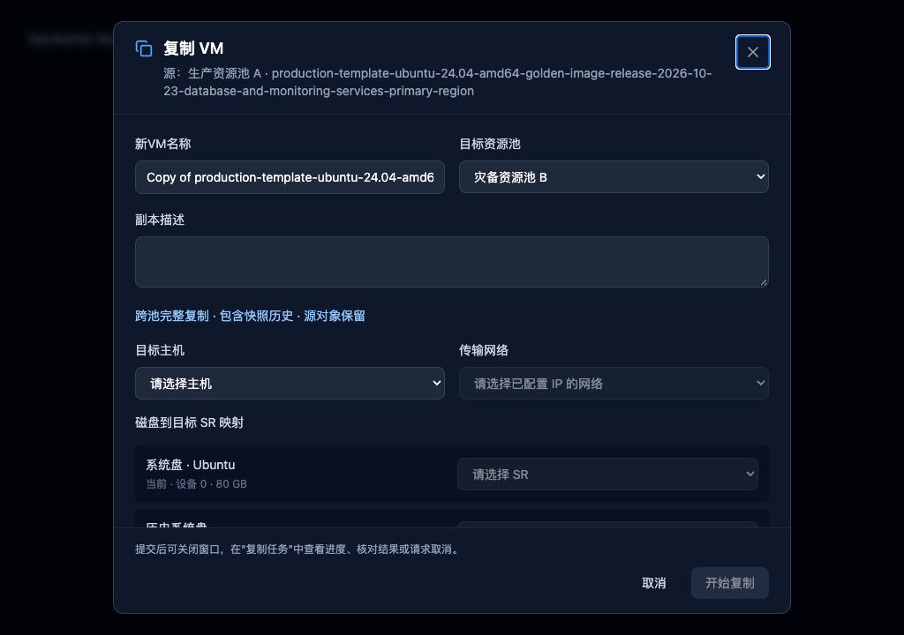
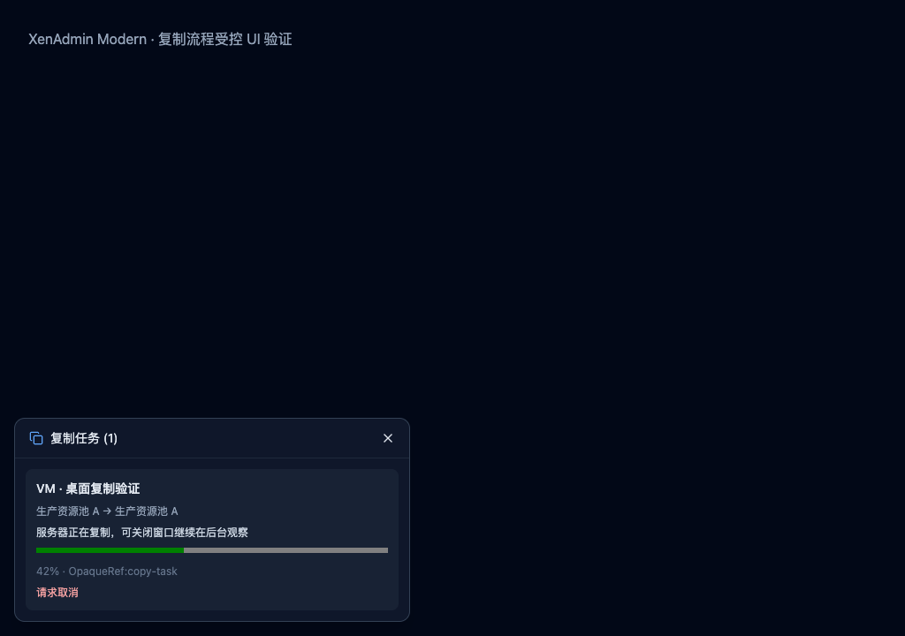

# VM 与模板复制优化实施记录（2026-10-23）

VM 与模板已接入统一复制流程：停机源对象支持同池快速克隆、同池完整复制，以及跨池完整复制。复制任务持久保存，窗口受理后即可关闭；任务完成后核对副本与源对象，提供结果定位。当前记录描述未提交工作区，基于 HEAD `7c3e7e67bb3fea8e59b2c4bc53d720392d1c982d`，不代表已安装应用已更新。

## 官方依据与实现选择

对照了 XAPI VM/Task 文档、XAPI 服务实现、XO 复制服务与表单、XenAdmin 复制 Action 和跨池映射向导。固定提交、文件地址及 SHA-256 见 [资料清单](implementation-sources.json)；行为依据和官方链接见 [复制规范](../../vm-copy.md)。后续审查修正了跨池快照语义、未提交记录恢复及源 Task 对目标连接的依赖，详见 [修复记录](review-fixes.md)。下列早期测试和截图记录不作为这次修复的验证结果。

- XO 固定于 `3923756ff5d56871c963616d67fe71b737e498b7`（2026-10-22）。采用明确的快速克隆/完整复制语义与异步任务；没有把 XO 在线快照准备当作本工具已经实现的功能。
- XenAdmin 固定于 `b210cd2c2d8547f5bb48b49d71f17429c7d65e44`（2023-12-13 公开开源提交）。采用主机直传路径和当前/历史设备完整映射；这不是 2026 商业 XenCenter 的源码快照。
- XAPI 固定于 `e2d37d9c0949ebdab915c0f4061ac3b0e90341c9`（2026-10-23）。实际服务要求 `copy=true` 的源对象停机；最新 `vdi_format_map` 有空映射默认值，保留默认值兼容旧版，不通过重放写操作试探参数。

## 审查问题的处理

编号对应 [原始审查](review.md)。

| 问题 | 当前处理 |
| --- | --- |
| 1：响应丢失后重复复制 | 提交前落盘，取得 Async Task 后持久保存任务引用；相同源 UUID 有未确认任务时不重复创建。无 Task 的丢失响应保留 unknown，不按名称认领副本。 |
| 2、11：切池后旧响应覆盖、猜测映射 | 按源对象、目标池和连接生命周期使请求失效；清空旧清单与映射，失败可原地重读。业务网络、主机和传输网络由用户明确选择。 |
| 3：不可写或不可达 SR 可选 | 批量读取实时能力、主机存活状态及 PBD/PIF；过滤只读、断开、已知空间为零的存储，跨池按目标主机筛选。提交前再次检查。 |
| 4、12：模态长任务、超时和恢复不足 | 使用独立持久复制服务；正常 pending 没有十分钟总期限。隐藏窗口仍观察，重启/重连只读取原 Task。取消以服务器终态为准。 |
| 5：说明挤压按钮 | 说明单独占一行，操作按钮不收缩、不换行，内容区域滚动。 |
| 6：方式与位置混合、缺少源池和结果定位 | VM/模板统一窗口，复制方式与目标池/SR 分开，始终展示源池与对象；结果通过任务面板定位。 |
| 7：清单 N+1 和重复全量请求 | SR 使用一次 `get_all_records`；同池重定位计划复用清单，磁盘/VIF 使用有限并发读取。复制完成只刷新目标池。 |
| 8：键盘和辅助标签 | form/onSubmit 支持 Enter，输入关联标签，关闭按钮有可访问名称。 |
| 9：遗漏历史磁盘、网卡和挂起镜像 | 枚举全部快照及设备，拒绝缺失或多余旧映射，检查目标主机可达性；核对源历史保留和副本当前设备。`copy=true` 不导入 VM 快照历史，已移除原先错误的目标快照数量核对。 |
| 10：把 Running 直接交给停机复制协议 | 当前明确限制 Halted 源对象。运行、暂停、挂起对象提示先正常关闭；在线准备未实现。 |

额外修正了完成记录的池身份边界：复制操作 DTO 携带源/目标池 UUID，“查看副本”与完成后的列表刷新均按 UUID 校验。连接 ID 被另一个池复用时禁用定位；原池以新连接接入后恢复定位。

取消与进度读取按同一操作串行处理，防止取消覆盖已完成结果，也不会丢弃进度读取期间的取消点击。取消前再次校验连接 client 和池 UUID；服务器不允许取消或已经终结时读取原终态。Task 清理失败保留已确认结果并警告，后续只重试清理。

副本已创建后名称或描述设置失败作为警告保留，不抹掉目标引用。结果核对异常时保留已知副本引用，不自动删除可能包含用户数据的对象。

## 本地验证

使用仓库固定工具链 Node `24.22.0`、npm `11.19.1`、lockfile v3；工具链门禁实际通过。Node 发行归档 SHA-256 为 `6a9724d9b50a5f22b4816cded441b5a8d9ddae546191a5e5b7efa5a5e2ee26d5`。

- `typecheck:node`、`typecheck:web`、`lint`、`build` 通过，日志见 [证据目录](implementation-evidence)。构建只生成应用 bundle。
- 复制专项 4 个文件、41 项通过，零 stderr、零 warning、零跳过。覆盖同池/跨池/模板、完整历史设备映射、未知结果恢复、防重复、取消并发、源保留、池身份变化和清理失败。
- 完整测试门禁通过：191 个文件、1886 项，零失败、零跳过、零 warning、零 stderr，严格测试清单无漂移。最终结果见 [机器可读验证记录](implementation-verification.json)，包含严格测试清单核对和诊断统计。工作区其他任务新增的测试已保留；导入测试只修正资源夹具、清单和组件卸载次序，未降低门禁或屏蔽警告。
- 受控浏览器验证当前实际 React 组件，在 1024×720、1280×800、1440×900 三档尺寸分别检查 VM 同池、模板同池和跨池映射，共 9 个场景。长名称及历史设备可滚动，没有横向溢出，底部按钮均在视窗内且只有一行。
- 浏览器中通过 Enter 只提交一次，窗口关闭后任务面板显示 42% 进度；请求取消后显示 cancelling，没有立即误报 cancelled。页面异常为空。脚本与结果见 [视觉结果](implementation-evidence/visual-results.json)。

## 未完成的产品范围与实机验收

在线快照准备、批量复制/命名规则、vGPU 映射、压缩及跨池磁盘格式转换仍未实现。系统模板跨池复制依赖 XAPI 是否允许 `migrate_send`，没有绕过能力检查。

上述验证使用本地模拟 XAPI、loopback 协议服务和受控 Chrome 页面。未执行真实池复制、真实服务器断线/取消/残留清理、安装更新或 Electron 完整集成验收。没有测量实际大盘传输吞吐量，也没有据此声称主机直传一定快于 XO 中转。

真实验收仍需覆盖：同池快速/完整复制、跨池 VM/用户模板、不同 SR 后端与版本/RBAC、包含独有历史 VIF/磁盘及挂起快照的大对象、服务端部分失败与取消清理，以及退出应用和主节点变化后的同一 Task 恢复。能力清单记录为 implemented，不记录为实机 verified。
