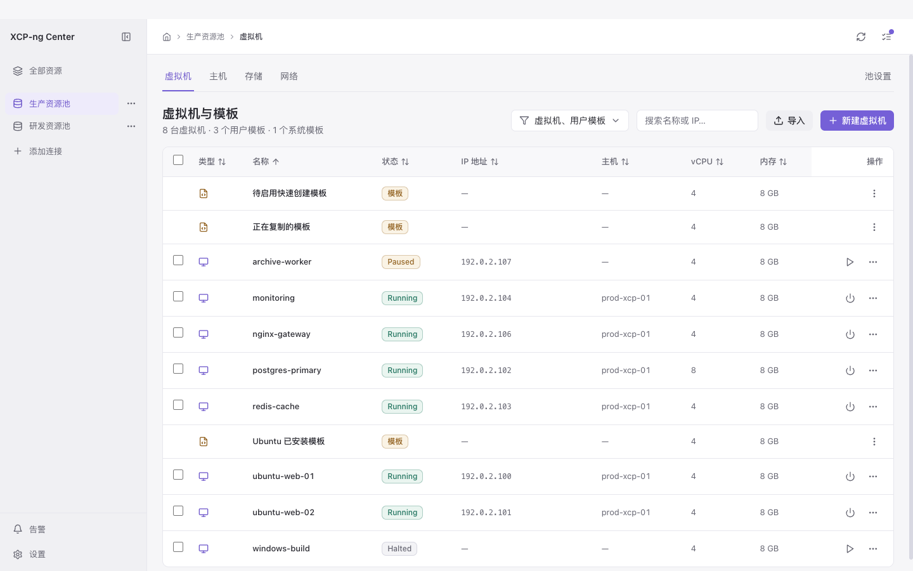
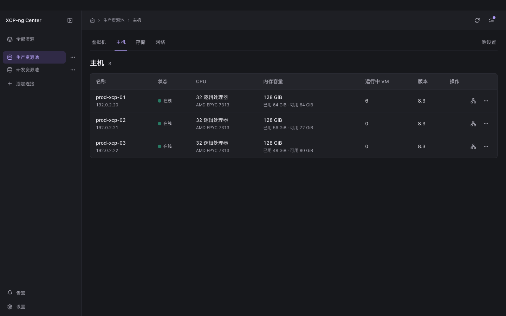
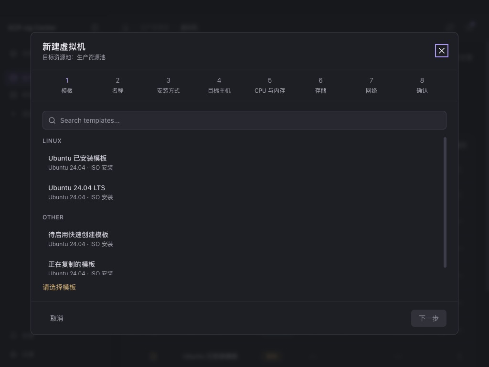

# 工作区界面重构验证

日期为 2026-11-10。检查对象是本次工作区源码与生产构建。

资源池、主机树和主机上下文标签页的后续改动见 [主机工作区验证](host-tree/README.md)。以下截图及 2438 项覆盖率结果保留首轮重构时的状态。

## 界面

- 连接后默认进入虚拟机与模板，旧仪表盘路径跳转到该列表。
- 侧栏选择全部资源或资源池，上方切换虚拟机、主机、存储、网络。断开连接归入对应池的更多菜单。
- 用户与权限、高可用进入池设置。外观与软件更新进入应用设置。
- 任务通知提供全部任务入口，操作、服务器、批量记录复用既有组件。后台观察维持常驻，记录页关闭重复轮询。
- 主机卡片改为表格，保留硬件信息、内存容量、运行数、接口详情和操作保护。删除重复资源池标题、范围选择器和常驻说明。
- VM 搜索、类型与多列排序保存到 URL，详情返回恢复原条件。池设置始终绑定显式连接，断线保持原范围，连接身份变化释放旧编辑状态。
- 移除闲置仪表盘页面、监控总览弹窗和对应局部状态。主机与 VM 的监控继续使用原图表和服务。

## 自动检查

| 检查 | 结果 |
| --- | --- |
| 工具链 | Node 24.22.0、npm 11.19.1、lockfile v3 |
| 完整覆盖率门禁 | 209 个测试文件、2438 项全部通过 |
| 测试诊断 | 0 失败、0 跳过、0 todo、0 only、0 警告、0 stderr |
| 测试清单 | 无新增、缺失或数量漂移 |
| Node/Web 类型检查 | 通过 |
| lint | 通过，max-warnings 0 |
| 生产构建 | main、preload、renderer 均通过 |
| diff 空白检查 | 通过 |

| 覆盖层 | 行 | 函数 | 分支 |
| --- | --- | --- | --- |
| 安全 | 98.76% | 100% | 86.84% |
| 协议 | 92.91% | 95.85% | 81.35% |
| 界面 | 82.48% | 63% | 83.42% |
| 其他 | 96.37% | 97.06% | 89.07% |

各层均达到仓库既有覆盖率门槛。完整门禁结果保存在 [test-gate.json](test-gate.json)。

专项用例检查了旧入口兼容、池范围切换、带编码的连接 ID、断线禁用、重连代次变化、后台指标与告警生命周期、VM 返回列表条件，以及通知和任务页同时显示时的取消互斥与终态保护。仪表盘专属测试随闲置页面移除，采集、资源可用性、统计空值及已观测零值由对应 store、资源页和主机监控测试覆盖。

## 浏览器检查

使用独立临时配置的无头 Chrome，访问 `tests/visual/frontend-theme.html`。夹具挂载真实 App、路由、store 和页面，仅提供明确的本地只读 XAPI 返回值。它不建立真实 XAPI 会话。

- 深浅主题、1024×768、1280×800、1440×900、1920×1080，共 21 条页面或标签路径，168 个组合。
- 长名称、空数据、读取错误、未连接四类状态，在 1024×768 下检查六个页面，共 24 个组合。
- 192 个场景均未发现页面横向溢出。全部正常路径有工作区和标题，浏览器运行时错误为零。
- 12 项交互均通过，覆盖折叠侧栏名称与设置入口、跨池保留资源类型、池内类型导航、菜单边界、Escape 焦点返回、任务面板边界及焦点、进入全部任务、主题应用与持久化、创建弹窗边界与目标池、Escape 关闭、长名称边界。

逐场景记录见 [visual-results.json](visual-results.json)。

## 参考与范围

导航参考 XenAdmin/XenCenter 的对象上下文标签及 XO 的资源组织。任务取消保留 XAPI Task 终态确认语义。[XenAdmin 主窗口](https://github.com/xcp-ng/xenadmin/blob/development/XenAdmin/MainWindow.cs) · [XenCenter 标签页](https://docs.xenserver.com/us/en/xencenter/current-release/intro-xencenterworkspace/tabs.html) · [XO 资源管理](https://docs.xen-orchestra.com/manage-your-infrastructure/manage_infrastructure) · [XAPI Task](https://xapi-project.github.io/xen-api/classes/task.html)

本次浏览器数据为固定夹具。真实资源池写操作、VNC、真实大文件传输、系统钥匙串、Electron 原生窗口和安装包运行尚未在本轮验收，源码与隔离浏览器结果不能替代这些证据。应用安装包需要另行构建和验收。
