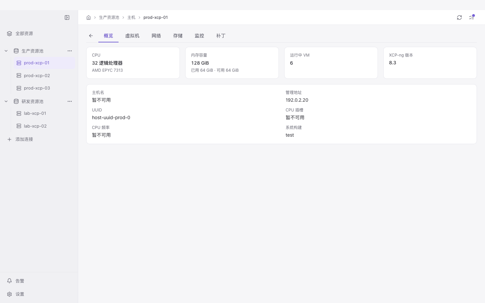
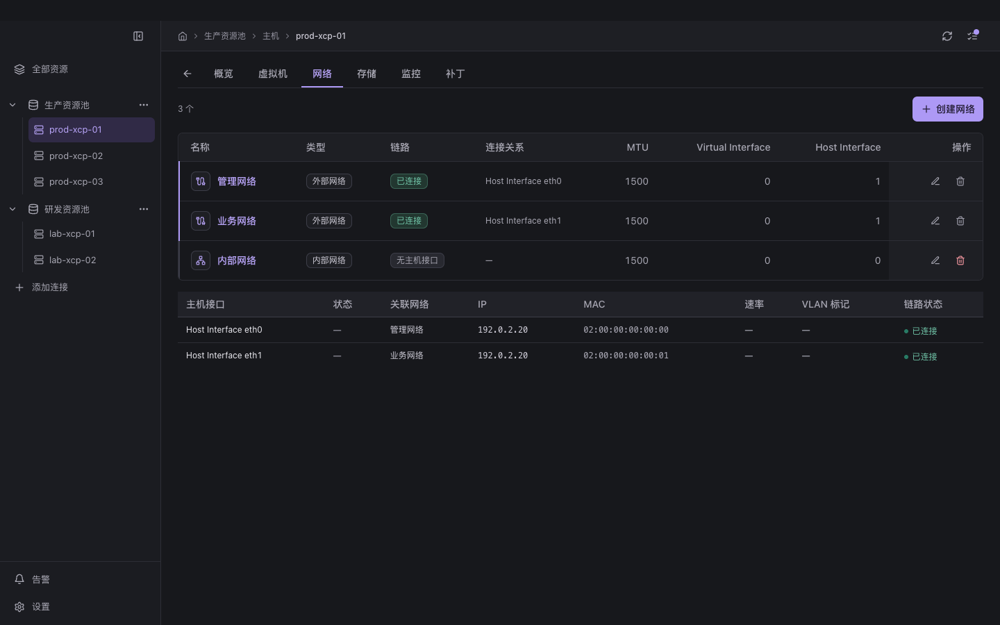

# 主机工作区验证

日期为 2026-11-10。检查对象是工作区源码、生产 bundle 与本地只读界面夹具。

## 实现

- 左侧使用资源池、主机两级对象树，展开按钮与对象选择分开。访问主机链接自动展开父池，当前主机独立标记，长名称保留完整 title。
- 选择主机直接显示硬件、内存、管理地址、UUID 与版本，提供概览、虚拟机、网络、存储、监控、补丁标签。移除重复标题、池标签和独立刷新行，顶栏保持 44px。
- 标签保存到 URL，切换主机保留标签并清除旧对象的筛选与详情。VM 详情返回保留原主机列表和搜索，创建向导默认当前主机并继续执行原验证。
- 运行与暂停 VM 使用 `resident_on`。停机与挂起 VM 先从本地 SR 的 PBD、VDI、VBD 关系定位主机，再使用 `affinity`。模板和没有明确归属的 VM 保留在池级清单。
- 主机存储通过 PBD 显示关联 SR，包括未挂接状态。网络保留池级对象，按当前主机 PIF 显示设备和链路。删除保护读取整个池的 PIF/VIF 关系。
- 关系读取失败保留具体错误和重新读取入口，连接身份或对象变化后丢弃旧响应。原操作确认、权限及写后结果核对继续使用现有实现。

## 官方实现与关系依据

对照 XenAdmin `development` 的固定树版本 `ba43130ffb30d05d1eb40187b8ef9f2de111468a`，主窗口按选中 Host/Pool 切换标签。主机存储从 `host.PBDs` 读取，网络使用池级清单并通过选中主机定位 PIF。VM `Home()` 按运行位置、本地存储、首选主机确定展示归属。[主窗口](https://github.com/xcp-ng/xenadmin/blob/ba43130ffb30d05d1eb40187b8ef9f2de111468a/XenAdmin/MainWindow.cs) · [主机存储](https://github.com/xcp-ng/xenadmin/blob/ba43130ffb30d05d1eb40187b8ef9f2de111468a/XenAdmin/TabPages/PhysicalStoragePage.cs) · [网络列表](https://github.com/xcp-ng/xenadmin/blob/ba43130ffb30d05d1eb40187b8ef9f2de111468a/XenAdmin/Controls/NetworkingTab/NetworkList.cs) · [VM 归属](https://github.com/xcp-ng/xenadmin/blob/ba43130ffb30d05d1eb40187b8ef9f2de111468a/XenModel/XenAPI-Extensions/VM.cs)

XAPI 的 PBD 连接 Host 与 SR，PIF 连接 Host 与 Network，VM 的 `resident_on` 和 `affinity` 分别描述当前驻留与首选主机。主机资源标签沿用这些关系，池身份和对象引用共同限定目标。[XAPI 概览](https://xapi-project.github.io/xen-api/overview.html) · [VM](https://xapi-project.github.io/xen-api/classes/vm.html) · [PBD](https://xapi-project.github.io/xen-api/classes/pbd.html) · [PIF](https://xapi-project.github.io/xen-api/classes/pif.html)

## 浏览器验证

真实 App、路由和 store 配合固定只读数据。深浅主题与 1024×768、1280×800、1440×900、1920×1080 四种桌面尺寸检查 26 条路径，共 208 个组合。长名称、空数据、读取失败、未连接四种状态各检查十个路径，合计 248 个场景。

20 项交互通过，覆盖主机树、父池展开、跨主机标签、VM 归属、PBD 过滤、网络接口、导航、菜单与 Escape 焦点、任务浮层、主题重载持久化、创建窗口及长名称边界。未发现页面横向溢出、缺失工作区或浏览器运行时错误。逐场景结果保存在 [visual-results.json](visual-results.json)。

## 自动检查

固定 Node 24.22.0、npm 11.19.1 下，完整覆盖率门禁通过 210 个文件、2453 项测试。零失败、零跳过、零 todo、零 only、零警告、零 stderr，严格测试清单无漂移。安全、协议、界面及其他层均达到既有覆盖率阈值。Node/Web 类型检查、lint、生产构建及 `git diff --check` 通过。机器可读结果保存在 [test-gate.json](test-gate.json)。

回归覆盖对象树选择、父节点自动展开、编码路径、跨池同引用、主机标签与返回状态、当前驻留与本地存储优先级、迁移更新、连接身份变化、SR/PBD 失败重试、网络主机接口与池级删除保护，以及向导选择模板后保留默认主机。

## 验收范围

本轮证据来自源码测试、隔离浏览器和生产 bundle。真实资源池写操作、Electron 原生窗口、钥匙串、VNC、传输及已安装应用运行尚未在本轮验收。
